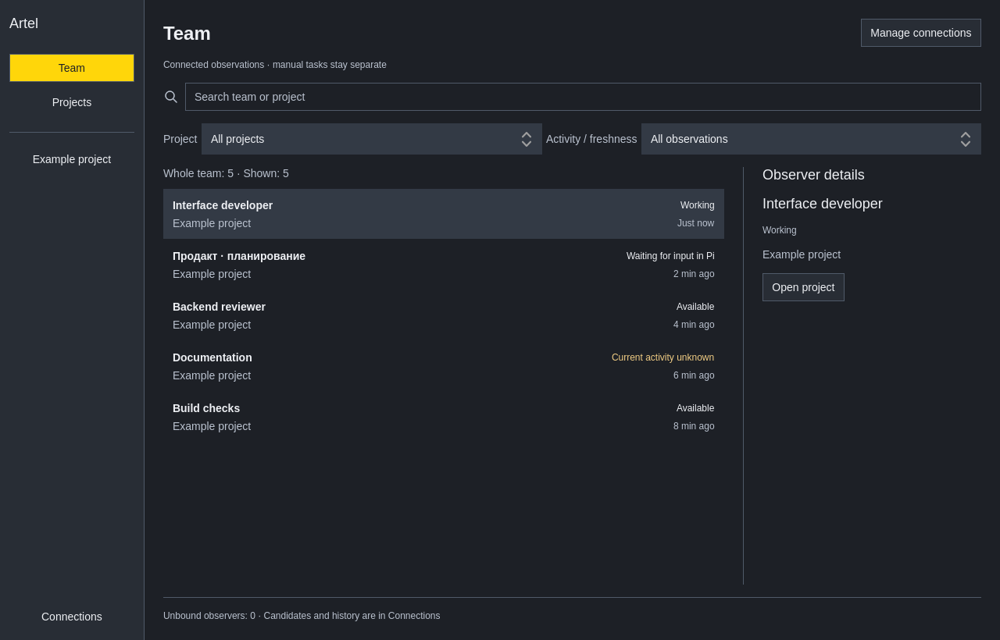

# Artel v2



[Russian team overview](docs/screenshots/team-overview-ru-1440.png) · [Manual workspace](docs/screenshots/manual-redesign-en-workspace.png) · [Native screenshot evidence](docs/screenshots/README.md) · [Design system](DESIGN.md)

A local, native project/task panel: Go API + CLI, SQLite storage and a standalone C++/Qt Quick desktop. This prototype provides a manual foundation and opt-in Pi observation; it is not an orchestrator. The former Telegram/Mattermost personal bot has been removed; see [cleanup inventory](docs/legacy-cleanup.md).

## Current slice

- `arteld`: loopback HTTP with public `/healthz`, private owner credential bootstrap, data-directory lock, versioned SQLite storage (`artel.sqlite`) and graceful SIGINT/SIGTERM shutdown. `/v1/*` requires Bearer auth and exposes projects, tasks, queues, consistent snapshots, paginated audit history and replayable SSE.
- Internal domain/app/store: manual transitions, queue CAS, archive rules, atomic audit events and idempotency receipts; exposed over HTTP and exercised by isolated integration/concurrency tests.
- `artelctl --help` / `--version`, `status --json`, and `snapshot --json` (unsupported arguments exit 2).
- `artel`: team-first native desktop with a virtualized bound-observer roster, independent search/project/activity filters and selected-observer inspector. Connections separates candidates/history from the team. Projects opens manual project overview/edit/archive, task editors and acceptance criteria, ordered queues, manual transitions and paginated history. Startup always opens Team; an empty registry never loads demo data.

Manual CRUD is available through both the desktop and API. Optional Pi 1.5.2 observation exposes candidates, explicit project bindings, reported activity and separate freshness, with no agent control or task completion inference. Desktop controls and best-effort claimed agterm session navigation preserve manual drafts. MR orchestration, delivery, remote access and deployment are outside this slice. Closing the UI does not stop the independently launched daemon.

## Build and checks

Dependencies: Go **1.26.3**, golangci-lint **2.10.1**, Qt **6.8+** (base/declarative, Quick Controls, Qt Test, qmllint and qmlformat), C++17 compiler, make, clang-format and Python 3 (delivery tests). Observer tests/build also require Node >=22.23.2, npm and Linux Python PTY support, with pinned Pi 1.5.2 in a private dependency workspace. Preflight diagnoses missing tools; it never installs host packages.

```sh
npm --prefix integrations/pi-observer ci --ignore-scripts
make lint test build
make test-race
make check          # lint, Go/Qt tests, race, build, public Pi SDK/PTY and full-stack acceptance
make package-check  # Arch only; disposable build/inspection, no installation
```

If the host linter differs, install the pinned version into a private tools directory and set `GOLANGCI_LINT=/path/to/golangci-lint`. Qt tools are resolved via `qmake6 -query QT_INSTALL_BINS`; overrides: `QMAKE`, `QT_BINS`. `JOBS` defaults to 2.

Arch packaging lives in `packaging/arch/`; the separate user unit is `packaging/systemd/arteld.service`. `make package-check` requires an unprivileged Arch environment with base-devel, Go, Qt base/declarative/SVG/Wayland, Node/npm, Python, desktop-file-utils, systemd and libarchive. It reports missing dependencies without installing them. It archives the current working tree's allowed source files (including uncommitted changes), builds with makepkg, checks the exact payload/desktop/unit and removes its temporary package. No token/database, package install hook or service activation is shipped. The package includes all three binaries, MIT license/template attribution, the `artel` desktop entry/icon and an inert standalone extension under `/usr/share/artel/pi-observer/`. Pi/Node are optional for observation only; daemon/CLI/desktop work without them. Nothing installs into Pi auto-discovery. Installation and user-service enablement remain separate owner decisions. Go CI remains enabled; by owner decision the remote native/full-stack/package job is temporarily paused for the local pilot. Local `make check`/`make package-check` remain mandatory. See [delivery limitations and re-enable criteria](docs/development.md#delivery-and-remaining-acceptance); a skipped remote job is not a passing package validation.

Run separately (no service is enabled or started by build scripts):

```sh
./build/bin/arteld
./build/bin/artelctl status --json
./build/bin/artelctl snapshot --json
./desktop/build/artel
```

The daemon defaults to `${XDG_DATA_HOME:-$HOME/.local/share}/artel/v2` and `${XDG_CONFIG_HOME:-$HOME/.config}/artel/local-owner.token`. First startup creates a 32-byte random owner secret (64 hex characters plus newline), never replaces an existing credential, and refuses unsafe ownership/permissions or symlinks. Private directories must be 0700 and the token file 0600; existing permissions are not silently repaired. Do not print or copy the token into command arguments, URLs or logs.

Independent absolute `arteld --data-dir PATH --token-file PATH --listen 127.0.0.1:PORT` overrides support isolated instances (`PORT=0` reports the actual ephemeral address). CLI supports `status|snapshot --json --endpoint http://127.0.0.1:PORT --token-file PATH`; status reads public liveness, snapshot reads the private credential internally. Requests have bounded timeouts, no proxies/redirects, and nonzero exits on failures. Browser Origin requests and mismatched Host headers are rejected. The validated domain contract is in [api/openapi.yaml](api/openapi.yaml).

Desktop supports the same `--endpoint http://127.0.0.1:PORT` and `--token-file PATH` overrides; it reads the private credential internally and never exposes it to QML or settings. It loads a consistent snapshot then subscribes to authenticated SSE, coalesces refreshes and reconnects with a new snapshot. Connection state and the last successful update remain visible. Offline data is cached in memory and read-only; there is no offline mutation queue. Drafts stay in the window and closing/discarding asks for confirmation. On conflict, reload and compare the current server text, then explicitly adopt its version while keeping the draft. An unknown save result can only retry the original key/payload, not submit an edited duplicate; a replaced database cannot receive the old draft silently. After database replacement, explicitly acknowledge abandonment of an uncertain old request to unlock the window without replaying it; copy the retained draft before discarding it and starting a new edit. Completed tasks are labelled “Completed manually”, not verified work.

Omarchy adapters read/watch its accent and language files without changing them, and query effective Hyprland rounding asynchronously. Shared Basic Quick Controls use neutral canon surfaces, the native system UI font, contrast-safe accent selection/focus and radius0–12 (fallback6). Absent Omarchy uses English, a dark theme and yellow accent. Russian/English catalogs are bundled, with English fallback for other languages. No user settings are written.

| Shortcut | Action |
| --- | --- |
| Ctrl+S (standard Save) | Save the visible manual editor when online and not pending/conflicted |
| Escape (standard Cancel) | Confirm discarding a visible manual draft; never discard a hidden draft from Team |
| Ctrl+Q (standard Quit) / window close | Close, confirming unsaved/unknown changes |
| Tab / Shift+Tab | Navigate controls |
| Standard copy/paste/select-all | Edit or copy draft text, including offline |

No single-letter shortcuts intercept text entry.

Tests run production QML offscreen and daemon processes with temporary paths/HOME and ephemeral ports; no running daemon is required. They exercise Cyrillic input, keyboard/mouse actions, ordering, manual states, archive/read-only, history pagination, conflicts, uncertain retries, offline drafts, close confirmation and live theme/language fixtures. Team is read-only: filtering/selection never changes the manual project or assigns work. Returning to Team retains the window's draft and base version with an explicit return action. Narrow/larger-font layouts use same-window details and Back; long fields/metadata scroll. For private capture commands and the fictional RU/EN/narrow/scaled/recovery matrix, see [screenshot evidence](docs/screenshots/README.md) and [DESIGN.md](DESIGN.md). Native acceptance tests also verify UI/daemon restart persistence, two-client conflicts, reorder/start races, SSE recovery and lost-response idempotency. Local package checks pass; Go CI is enabled, while remote native/package CI is explicitly paused for the local pilot. No normal-session desktop smoke is claimed. SQLite uses WAL, foreign keys, FULL synchronous commits and a persistent database instance UUID; incompatible databases fail startup without recreation. Do not point the daemon at a legacy bot database.

Mutations require a UUID `Idempotency-Key`; edits/transitions require expected versions, and leaving queued also requires the queue version. Retry uncertain outcomes with the same key/payload. Snapshot queues are an array of `{project_id,queue_version,task_ids}` records. Audit `before`/`after` objects map `object-kind:UUID` keys to changed fields, including versions. History scans at most `limit` events (1–500, default 100) and advances `next_cursor` even when filters match nothing; task filters include queue events that change that task. SSE uses `instance_id` and `after` from a snapshot, sends compact invalidations, polls the persisted log every 100 ms and heartbeats every 15 seconds. Each stream buffers at most 100 events and disconnects writes blocked for 2 seconds; reconnect with a new snapshot or replay cursor. Wrong-instance/future cursors return `409 reset_required` before streaming. Snapshots exceeding 32 MiB fail with 413, never partial data. The OpenAPI 3.0.3 document is checked using the pinned Go kin-openapi validator (no downloaded CLI validator).

See [development, observer provisioning/resume/bind/revoke/prune and isolated CLI examples](docs/development.md), [foundation evidence](docs/plans/completed/20261117-artel-v2-foundation-desktop.md) and [architecture direction](docs/architecture/20261117-artel-v2-direction.md). The [roadmap](docs/roadmap.md) tracks merged milestones and the next product step. `docs/plans/completed/` contains the completed foundation plan and historical bot plans; the latter are not active instructions. `docs/experiments/` is research, not a runtime dependency.
